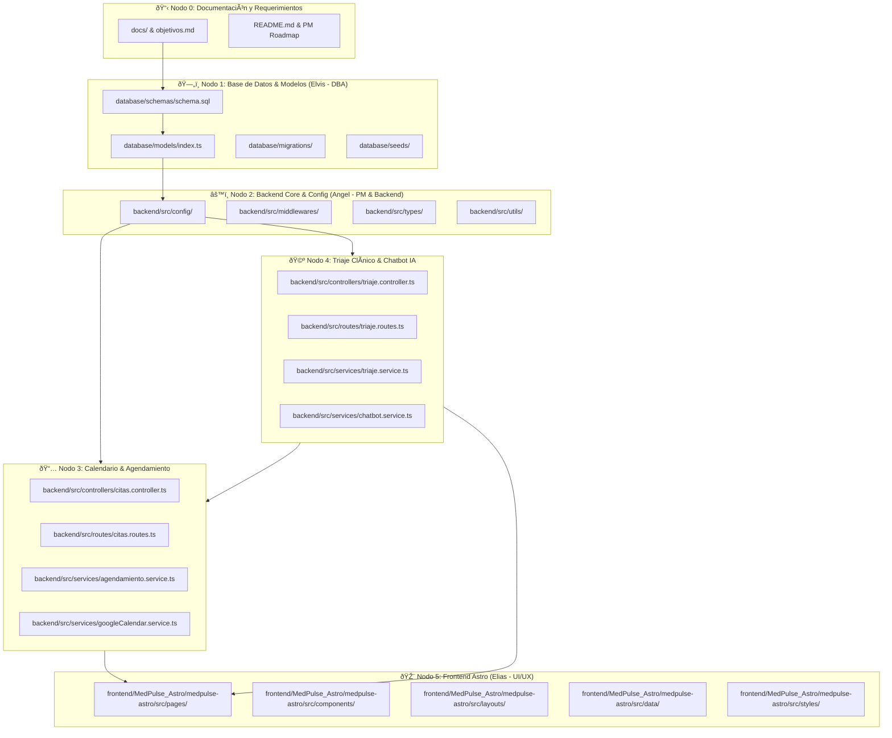

# 🌐 Red de Nodos de Arquitectura (Knowledge Graph)
# Sistema Inteligente de Gestión de Citas Clínicas (MedPulse)

> **Versión:** 1.0.0  
> **Última Actualización:** 2026-10-15  
> **Estado:** Activo y Sincronizado  

---

## 🗺️ Diagrama Mermaid de Arquitectura del Sistema

---

## 🗂️ Índice de Módulos y Mapeo Quirúrgico de Archivos

### 🔹 [Nodo 0: Documentación y Requerimientos](file:///c:/Users/fioni/Documents/Proyecto%20de%20SOftware/objetivos.md)
* **Responsable:** Angel (PM)
* **Propósito:** Especificación de objetivos, alcance, reglas de negocio y entregables del sistema.
* **Archivos asociados:**
  - [objetivos.md](file:///c:/Users/fioni/Documents/Proyecto%20de%20SOftware/objetivos.md)
  - [README.md](file:///c:/Users/fioni/Documents/Proyecto%20de%20SOftware/README.md)
  - [docs/flows/ESPECIFICACION_UI_CALENDARIO_Y_TRIAJE.md](file:///c:/Users/fioni/Documents/Proyecto%20de%20SOftware/docs/flows/ESPECIFICACION_UI_CALENDARIO_Y_TRIAJE.md)
  - [docs/MEDPULSE_NOTEBOOKLM_PLAN_V2.md](file:///c:/Users/fioni/Documents/Proyecto%20de%20SOftware/docs/MEDPULSE_NOTEBOOKLM_PLAN_V2.md)
  - [docs/MEDPULSE_NOTEBOOKLM_KNOWLEDGE_BASE.md](file:///c:/Users/fioni/Documents/Proyecto%20de%20SOftware/docs/MEDPULSE_NOTEBOOKLM_KNOWLEDGE_BASE.md)
  - [.agents/scripts/sync_drive.mjs](file:///c:/Users/fioni/Documents/Proyecto%20de%20SOftware/.agents/scripts/sync_drive.mjs) (Sincronizador automático a `G:\Mi unidad\MedPulse\`)
  - [start-dev.mjs](file:///c:/Users/fioni/Documents/Proyecto%20de%20SOftware/start-dev.mjs) (Orquestador unificado de inicio simultáneo)
  - [iniciar.bat](file:///c:/Users/fioni/Documents/Proyecto%20de%20SOftware/iniciar.bat) (Lanzador con doble clic para Windows)
  - [iniciar.ps1](file:///c:/Users/fioni/Documents/Proyecto%20de%20SOftware/iniciar.ps1) (Lanzador para PowerShell)
  - [package.json](file:///c:/Users/fioni/Documents/Proyecto%20de%20SOftware/package.json) (Scripts npm en la raíz del proyecto)
  - [docs/](file:///c:/Users/fioni/Documents/Proyecto%20de%20SOftware/docs)

### 🔹 [Nodo 1: Base de Datos & Persistencia](file:///c:/Users/fioni/Documents/Proyecto%20de%20SOftware/database/init_local_db.sql)
* **Responsable:** Elvis (DBA)
* **Propósito:** DDL relacional en PostgreSQL 14+, tipos de dominio, disparadores de auditoría y restricción de exclusión física anti double-booking. Script único auto-ejecutable con seeds reales (@gmail.com).
* **Archivos asociados:**
  - [database/init_local_db.sql](file:///c:/Users/fioni/Documents/Proyecto%20de%20SOftware/database/init_local_db.sql)
  - [database/schemas/schema.sql](file:///c:/Users/fioni/Documents/Proyecto%20de%20SOftware/database/schemas/schema.sql)
  - [database/models/index.ts](file:///c:/Users/fioni/Documents/Proyecto%20de%20SOftware/database/models/index.ts)
  - [database/seeds/01_initial_seeds.sql](file:///c:/Users/fioni/Documents/Proyecto%20de%20SOftware/database/seeds/01_initial_seeds.sql)

### 🔹 [Nodo 2: Backend Core & Configuración (Vercel Serverless)](file:///c:/Users/fioni/Documents/Proyecto%20de%20SOftware/backend/src)
* **Responsable:** Angel (Backend)
* **Propósito:** Servidor HTTP Express / TypeScript preparado para Vercel Serverless (`backend/api/index.ts`, `backend/vercel.json`), registro de pacientes con Gmail y Cédula panameña (`POST /api/auth/register-paciente`), login de roles y conexión a PostgreSQL.
* **Archivos asociados:**
  - [backend/src/controllers/auth.controller.ts](file:///c:/Users/fioni/Documents/Proyecto%20de%20SOftware/backend/src/controllers/auth.controller.ts)
  - [backend/src/routes/auth.routes.ts](file:///c:/Users/fioni/Documents/Proyecto%20de%20SOftware/backend/src/routes/auth.routes.ts)
  - [backend/src/routes/db.routes.ts](file:///c:/Users/fioni/Documents/Proyecto%20de%20SOftware/backend/src/routes/db.routes.ts)
  - [backend/src/server.ts](file:///c:/Users/fioni/Documents/Proyecto%20de%20SOftware/backend/src/server.ts)
  - [backend/api/index.ts](file:///c:/Users/fioni/Documents/Proyecto%20de%20SOftware/backend/api/index.ts)
  - [backend/vercel.json](file:///c:/Users/fioni/Documents/Proyecto%20de%20SOftware/backend/vercel.json)

### 🔹 [Nodo 3: Módulo de Calendario y Agendamiento](file:///c:/Users/fioni/Documents/Proyecto%20de%20SOftware/backend/src/services)
* **Responsable:** Angel / Elvis
* **Propósito:** Motor de asignación automática de citas (`POST /api/citas/asignar-automatica`) sin elección manual de hora por el paciente, verificación de colisiones en tiempo real, distinción de creador (`PACIENTE` vs `ADMINISTRADOR`) y sincronización con Google Calendar.
* **Archivos asociados:**
  - [backend/src/controllers/citas.controller.ts](file:///c:/Users/fioni/Documents/Proyecto%20de%20SOftware/backend/src/controllers/citas.controller.ts)
  - [backend/src/routes/citas.routes.ts](file:///c:/Users/fioni/Documents/Proyecto%20de%20SOftware/backend/src/routes/citas.routes.ts)
  - [backend/src/services/agendamiento.service.ts](file:///c:/Users/fioni/Documents/Proyecto%20de%20SOftware/backend/src/services/agendamiento.service.ts)
  - [backend/src/types/index.ts](file:///c:/Users/fioni/Documents/Proyecto%20de%20SOftware/backend/src/types/index.ts)

### 🔹 [Nodo 4: Módulo de Triaje Clínico & Chatbot WhatsApp (Fuera de la Web)](file:///c:/Users/fioni/Documents/Proyecto%20de%20SOftware/backend/src/services)
* **Responsable:** Angel
* **Propósito:** Evaluación conversacional de síntomas canalizada por WhatsApp, vinculación del número personal del usuario como cuenta de empresa (`GET/POST /api/whatsapp/config`), clasificación por niveles de triaje (`LEVE`, `MODERADO`, `URGENTE`), derivación a especialidades y guardado automático de citas en el calendario (`POST /api/whatsapp/simular` y `POST /api/whatsapp/webhook`).
* **Archivos asociados:**
  - [backend/src/services/chatbot.service.ts](file:///c:/Users/fioni/Documents/Proyecto%20de%20SOftware/backend/src/services/chatbot.service.ts)
  - [backend/src/controllers/whatsapp.controller.ts](file:///c:/Users/fioni/Documents/Proyecto%20de%20SOftware/backend/src/controllers/whatsapp.controller.ts)
  - [backend/src/routes/whatsapp.routes.ts](file:///c:/Users/fioni/Documents/Proyecto%20de%20SOftware/backend/src/routes/whatsapp.routes.ts)
  - [backend/src/controllers/triaje.controller.ts](file:///c:/Users/fioni/Documents/Proyecto%20de%20SOftware/backend/src/controllers/triaje.controller.ts)
  - [backend/src/routes/triaje.routes.ts](file:///c:/Users/fioni/Documents/Proyecto%20de%20SOftware/backend/src/routes/triaje.routes.ts)
  - [backend/src/services/triaje.service.ts](file:///c:/Users/fioni/Documents/Proyecto%20de%20SOftware/backend/src/services/triaje.service.ts)
  - [docs/flows/ESPECIFICACION_UI_WHATSAPP_EMPRESA.md](file:///c:/Users/fioni/Documents/Proyecto%20de%20SOftware/docs/flows/ESPECIFICACION_UI_WHATSAPP_EMPRESA.md)

### 🔹 [Nodo 5: Frontend Web en Astro & Diseño Stitch](file:///c:/Users/fioni/Documents/Proyecto%20de%20SOftware/frontend/MedPulse_Astro/medpulse-astro)
* **Responsable:** Elias (Frontend) / Antigravity
* **Propósito:** Interfaz de usuario responsiva mobile-first basada en el sistema de diseño **Clinical Pulse Dark** generado en Google Stitch (`projects/178164831722145904`), desplegada estáticamente en Vercel con API dinámica (`src/data/api.ts`).
* **Componentes Clave:**
  - **Dashboard Clínico Ejecutivo:** [src/pages/dashboard.astro](file:///c:/Users/fioni/Documents/Proyecto%20de%20SOftware/frontend/MedPulse_Astro/medpulse-astro/src/pages/dashboard.astro) centro de control con barras animadas, telemetría por especialidad y horarios pico, medidores de consultorios y filtros reactivos.
  - **Login & Registro con Gmail:** [src/pages/login.astro](file:///c:/Users/fioni/Documents/Proyecto%20de%20SOftware/frontend/MedPulse_Astro/medpulse-astro/src/pages/login.astro) con portales por rol y registro directo con cuenta `@gmail.com` conectado a backend.
  - **Recepción de Pacientes Secretaría:** [src/pages/secretaria/pacientes.astro](file:///c:/Users/fioni/Documents/Proyecto%20de%20SOftware/frontend/MedPulse_Astro/medpulse-astro/src/pages/secretaria/pacientes.astro) con alta rápida de cédula panameña, búsqueda en tiempo real y agendamiento en recepción.
  - **Agendamiento Automático:** [src/pages/paciente/reservar.astro](file:///c:/Users/fioni/Documents/Proyecto%20de%20SOftware/frontend/MedPulse_Astro/medpulse-astro/src/pages/paciente/reservar.astro) donde el paciente selecciona médico y fecha, y el sistema calcula y asigna automáticamente la ranura libre óptima sin selección manual de hora.
  - **Navegación Móvil Táctil:** [src/layouts/Layout.astro](file:///c:/Users/fioni/Documents/Proyecto%20de%20SOftware/frontend/MedPulse_Astro/medpulse-astro/src/layouts/Layout.astro) con drawer lateral, overlay backdrop y barra fija inferior de navegación táctil (Bottom Navigation Bar) adaptada por rol.
* **Archivos asociados:**
  - [frontend/MedPulse_Astro/medpulse-astro/src/pages/dashboard.astro](file:///c:/Users/fioni/Documents/Proyecto%20de%20SOftware/frontend/MedPulse_Astro/medpulse-astro/src/pages/dashboard.astro)
  - [frontend/MedPulse_Astro/medpulse-astro/src/data/api.ts](file:///c:/Users/fioni/Documents/Proyecto%20de%20SOftware/frontend/MedPulse_Astro/medpulse-astro/src/data/api.ts)
  - [frontend/MedPulse_Astro/medpulse-astro/src/styles/global.css](file:///c:/Users/fioni/Documents/Proyecto%20de%20SOftware/frontend/MedPulse_Astro/medpulse-astro/src/styles/global.css)
  - [frontend/MedPulse_Astro/medpulse-astro/src/layouts/Layout.astro](file:///c:/Users/fioni/Documents/Proyecto%20de%20SOftware/frontend/MedPulse_Astro/medpulse-astro/src/layouts/Layout.astro)
  - [frontend/MedPulse_Astro/medpulse-astro/src/pages/secretaria/pacientes.astro](file:///c:/Users/fioni/Documents/Proyecto%20de%20SOftware/frontend/MedPulse_Astro/medpulse-astro/src/pages/secretaria/pacientes.astro)
  - [frontend/MedPulse_Astro/medpulse-astro/src/pages/pacientes.astro](file:///c:/Users/fioni/Documents/Proyecto%20de%20SOftware/frontend/MedPulse_Astro/medpulse-astro/src/pages/pacientes.astro)
  - [frontend/MedPulse_Astro/medpulse-astro/src/pages/login.astro](file:///c:/Users/fioni/Documents/Proyecto%20de%20SOftware/frontend/MedPulse_Astro/medpulse-astro/src/pages/login.astro)
  - [frontend/MedPulse_Astro/medpulse-astro/src/pages/paciente/reservar.astro](file:///c:/Users/fioni/Documents/Proyecto%20de%20SOftware/frontend/MedPulse_Astro/medpulse-astro/src/pages/paciente/reservar.astro)
  - [frontend/MedPulse_Astro/medpulse-astro/src/pages/citas.astro](file:///c:/Users/fioni/Documents/Proyecto%20de%20SOftware/frontend/MedPulse_Astro/medpulse-astro/src/pages/citas.astro)
  - [DESIGN.md](file:///c:/Users/fioni/Documents/Proyecto%20de%20SOftware/DESIGN.md)
  - [.agents/rules/stitch_design_system.md](file:///c:/Users/fioni/Documents/Proyecto%20de%20SOftware/.agents/rules/stitch_design_system.md)
  - [.agents/skills/stitch-vibrant-ui/SKILL.md](file:///c:/Users/fioni/Documents/Proyecto%20de%20SOftware/.agents/skills/stitch-vibrant-ui/SKILL.md)
  - [.agents/skills/emil-design-eng/SKILL.md](file:///c:/Users/fioni/Documents/Proyecto%20de%20SOftware/.agents/skills/emil-design-eng/SKILL.md)
  - [.agents/skills/impeccable/SKILL.md](file:///c:/Users/fioni/Documents/Proyecto%20de%20SOftware/.agents/skills/impeccable/SKILL.md)

