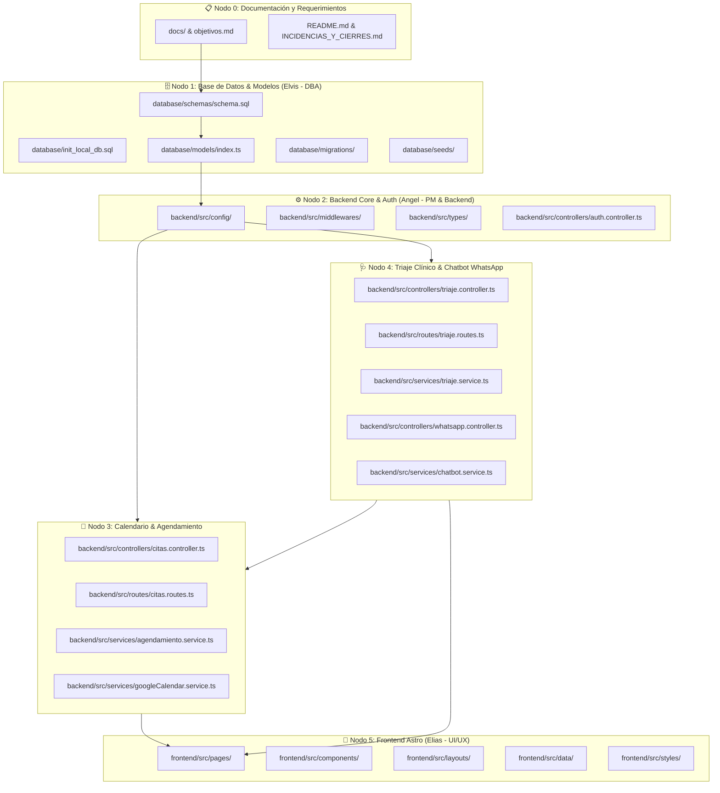

# 🌐 Red de Nodos de Arquitectura (Knowledge Graph)
# Sistema Inteligente de Gestión de Citas Clínicas (MedPulse)

> **Versión:** 1.1.0  
> **Última Actualización:** 2026-11-12  
> **Estado:** Activo y Sincronizado  

---

## 🗺️ Diagrama Mermaid de Arquitectura del Sistema

---

## 🗂️ Índice de Módulos y Mapeo Quirúrgico de Archivos

### 🔹 [Nodo 0: Documentación y Requerimientos](../../objetivos.md)
* **Responsable:** Angel (PM)
* **Propósito:** Especificación de objetivos, alcance, reglas de negocio, cierres por bloque y scripts de inicio.
* **Archivos asociados:**
  - [objetivos.md](../../objetivos.md)
  - [README.md](../../README.md)
  - [docs/INCIDENCIAS_Y_CIERRES.md](../../docs/INCIDENCIAS_Y_CIERRES.md)
  - [docs/flows/ESPECIFICACION_UI_CALENDARIO_Y_TRIAJE.md](../../docs/flows/ESPECIFICACION_UI_CALENDARIO_Y_TRIAJE.md)
  - [docs/flows/ESPECIFICACION_UI_WHATSAPP_EMPRESA.md](../../docs/flows/ESPECIFICACION_UI_WHATSAPP_EMPRESA.md)
  - [docs/flows/ESPECIFICACION_UI_REDISENO_RESPONSIVE.md](../../docs/flows/ESPECIFICACION_UI_REDISENO_RESPONSIVE.md)
  - [docs/MEDPULSE_NOTEBOOKLM_PLAN_V2.md](../../docs/MEDPULSE_NOTEBOOKLM_PLAN_V2.md)
  - [docs/MEDPULSE_NOTEBOOKLM_KNOWLEDGE_BASE.md](../../docs/MEDPULSE_NOTEBOOKLM_KNOWLEDGE_BASE.md)
  - [start-dev.mjs](../../start-dev.mjs)
  - [iniciar.bat](../../iniciar.bat)
  - [iniciar.ps1](../../iniciar.ps1)
  - [package.json](../../package.json)

### 🔹 [Nodo 1: Base de Datos & Persistencia](../../database/init_local_db.sql)
* **Responsable:** Elvis (DBA)
* **Propósito:** DDL relacional en PostgreSQL 14+, tipos de dominio, disparadores de auditoría y restricción de exclusión física anti double-booking.
* **Archivos asociados:**
  - [database/init_local_db.sql](../../database/init_local_db.sql)
  - [database/schemas/schema.sql](../../database/schemas/schema.sql)
  - [database/schemas/README.md](../../database/schemas/README.md)
  - [database/migrations/001_initial_schema.sql](../../database/migrations/001_initial_schema.sql)
  - [database/models/index.ts](../../database/models/index.ts)
  - [database/seeds/01_initial_seeds.sql](../../database/seeds/01_initial_seeds.sql)

### 🔹 [Nodo 2: Backend Core & Configuración](../../backend/src/server.ts)
* **Responsable:** Angel (Backend)
* **Propósito:** Servidor HTTP Express / TypeScript (`backend/api/index.ts` para Vercel), autenticación por roles, registro de pacientes con cédula panameña y conexión resiliente a PostgreSQL.
* **Archivos asociados:**
  - [backend/src/server.ts](../../backend/src/server.ts)
  - [backend/src/config/db.ts](../../backend/src/config/db.ts)
  - [backend/src/config/env.ts](../../backend/src/config/env.ts)
  - [backend/src/middlewares/auth.middleware.ts](../../backend/src/middlewares/auth.middleware.ts)
  - [backend/src/controllers/auth.controller.ts](../../backend/src/controllers/auth.controller.ts)
  - [backend/src/routes/auth.routes.ts](../../backend/src/routes/auth.routes.ts)
  - [backend/src/routes/db.routes.ts](../../backend/src/routes/db.routes.ts)
  - [backend/api/index.ts](../../backend/api/index.ts)
  - [backend/vercel.json](../../backend/vercel.json)

### 🔹 [Nodo 3: Módulo de Calendario y Agendamiento](../../backend/src/services/agendamiento.service.ts)
* **Responsable:** Angel / Elvis
* **Propósito:** Asignación automática y por horario específico, prevención anti double-booking, estados (`PENDIENTE` → `CONFIRMADA`) y sincronización con Google Calendar.
* **Archivos asociados:**
  - [backend/src/controllers/citas.controller.ts](../../backend/src/controllers/citas.controller.ts)
  - [backend/src/routes/citas.routes.ts](../../backend/src/routes/citas.routes.ts)
  - [backend/src/services/agendamiento.service.ts](../../backend/src/services/agendamiento.service.ts)
  - [backend/src/services/googleCalendar.service.ts](../../backend/src/services/googleCalendar.service.ts)
  - [backend/src/types/index.ts](../../backend/src/types/index.ts)

### 🔹 [Nodo 4: Módulo de Triaje Clínico & Chatbot WhatsApp](../../backend/src/services/chatbot.service.ts)
* **Responsable:** Angel
* **Propósito:** Evaluación conversacional por WhatsApp (`@whiskeysockets/baileys` + QR en vivo), extracción NLU (fecha, hora, cédula, nombre), triaje (`LEVE`, `MODERADO`, `URGENTE`) y creación de citas sincronizadas con la web.
* **Archivos asociados:**
  - [backend/src/services/chatbot.service.ts](../../backend/src/services/chatbot.service.ts)
  - [backend/src/controllers/whatsapp.controller.ts](../../backend/src/controllers/whatsapp.controller.ts)
  - [backend/src/routes/whatsapp.routes.ts](../../backend/src/routes/whatsapp.routes.ts)
  - [backend/src/controllers/triaje.controller.ts](../../backend/src/controllers/triaje.controller.ts)
  - [backend/src/routes/triaje.routes.ts](../../backend/src/routes/triaje.routes.ts)
  - [backend/src/services/triaje.service.ts](../../backend/src/services/triaje.service.ts)

### 🔹 [Nodo 5: Frontend Web en Astro](../../frontend/src/pages/dashboard.astro)
* **Responsable:** Elias (Frontend) / Antigravity
* **Propósito:** Interfaz responsiva multi-rol (**Admin**, **Secretaria**, **Médico**, **Paciente**) con tema **Clinical Pulse Dark** y rutas dedicadas de agendamiento por rol.
* **Archivos asociados:**
  - [frontend/src/layouts/Layout.astro](../../frontend/src/layouts/Layout.astro)
  - [frontend/src/components/Calendar.astro](../../frontend/src/components/Calendar.astro)
  - [frontend/src/components/Appointments.astro](../../frontend/src/components/Appointments.astro)
  - [frontend/src/components/StaffBookingForm.astro](../../frontend/src/components/StaffBookingForm.astro)
  - [frontend/src/data/api.ts](../../frontend/src/data/api.ts)
  - [frontend/src/styles/global.css](../../frontend/src/styles/global.css)
  - [frontend/src/pages/dashboard.astro](../../frontend/src/pages/dashboard.astro)
  - [frontend/src/pages/reservar.astro](../../frontend/src/pages/reservar.astro)
  - [frontend/src/pages/secretaria/reservar.astro](../../frontend/src/pages/secretaria/reservar.astro)
  - [frontend/src/pages/paciente/reservar.astro](../../frontend/src/pages/paciente/reservar.astro)
  - [frontend/src/pages/whatsapp.astro](../../frontend/src/pages/whatsapp.astro)
  - [frontend/src/pages/login.astro](../../frontend/src/pages/login.astro)
  - [DESIGN.md](../../DESIGN.md)
  - [.agents/rules/stitch_design_system.md](../../.agents/rules/stitch_design_system.md)
