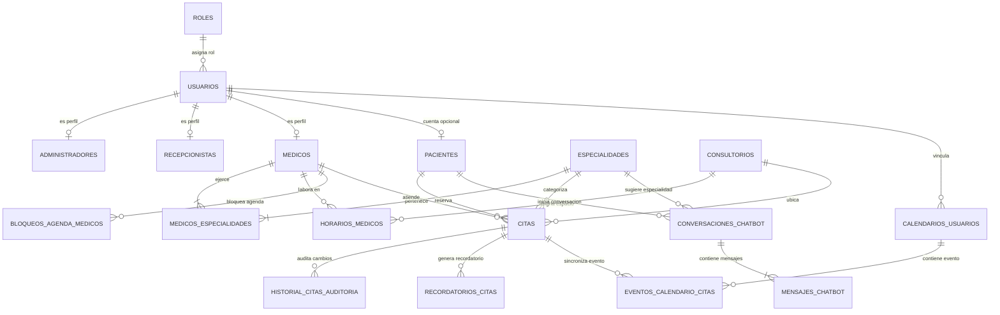

# 🗄️ Arquitectura y Modelo de Base de Datos (PostgreSQL)

**Autor / Responsable:** Elvis (DBA)  
**Motor:** PostgreSQL 14+ con extensiones `uuid-ossp` y `btree_gist`  
**Ubicación de Scripts:**
- DDL Consolidado: [`database/schemas/schema.sql`](file:///c:/Git/Antigravity/sistema-citas-clinicas/database/schemas/schema.sql)
- Migración Versionada: [`database/migrations/001_initial_schema.sql`](file:///c:/Git/Antigravity/sistema-citas-clinicas/database/migrations/001_initial_schema.sql)
- Seeds Iniciales de Prueba: [`database/seeds/01_initial_seeds.sql`](file:///c:/Git/Antigravity/sistema-citas-clinicas/database/seeds/01_initial_seeds.sql)

---

## 📌 1. Visión General y Objetivos Técnicos

El modelo de datos está optimizado para satisfacer con alta fidelidad los objetivos del proyecto:
1. **Motor de Agendamiento Anti-Colisiones (Zero Double-Booking):** Implementado con una restricción de exclusión física (`EXCLUSION CONSTRAINT`) a nivel de motor PostgreSQL mediante la extensión `btree_gist` y el tipo de dato temporal `TSRANGE`.
2. **Soporte de Triaje y Chatbot IA 24/7 (WhatsApp):** Persistencia de sesiones, contexto en `JSONB`, niveles de triaje clasificados (`LEVE`, `MODERADO`, `URGENTE`) y trazabilidad de mensajes e intenciones.
3. **Reducción de Ausentismo y Sincronización de Calendarios:** Tablas de recordatorios multicanal (`recordatorios_citas`) y almacenamiento de tokens y eventos sincronizados con **Google Calendar** (`calendarios_usuarios`, `eventos_calendario_citas`).
4. **Control de Acceso Basado en Roles (RBAC):** `ADMINISTRADOR`, `RECEPCIONISTA`, `MEDICO` y `PACIENTE`.
5. **Auditoría Transaccional:** Registro histórico automático de transiciones de estados de citas médicas mediante triggers en PostgreSQL.

---

## 📊 2. Diagrama Entidad - Relación (Mermaid)



---

## 🛡️ 3. Mecanismo de Garantía Anti-Colisión (Double-Booking)

En la tabla [`citas`](file:///c:/Git/Antigravity/sistema-citas-clinicas/database/schemas/schema.sql#L190-L225), se implementó la siguiente restricción estricta:

```sql
CONSTRAINT uq_medico_no_doble_agendamiento EXCLUDE USING gist (
    medico_id WITH =,
    rango_tiempo WITH &&
) WHERE (estado IN ('PENDIENTE', 'CONFIRMADA', 'EN_CONSULTA'));
```

### ¿Cómo funciona?
* `rango_tiempo` es una columna generada de tipo `TSRANGE` que abarca `[fecha_hora_inicio, fecha_hora_fin)`.
* La restricción de exclusión `GiST` evalúa si existe algún registro donde `medico_id` sea igual (`=`) y los rangos de tiempo se intersecten o solapen (`&&`).
* La cláusula `WHERE` asegura que si una cita fue **`CANCELADA`** o marcada como **`NO_ASISTIO`**, el horario se libere automáticamente para que otro paciente o el chatbot pueda agendarla sin conflictos.

---

## 🤖 4. Módulo de Chatbot IA & WhatsApp

* **`conversaciones_chatbot`:** 
  * `whatsapp_from`: Identificador del número internacional (ej. `+51988887777`).
  * `contexto_conversacion` (`JSONB`): Almacena variables de estado dinámicas del flujo conversacional (paso actual, médico seleccionado, slots de horario propuestos).
  * `nivel_triaje`: Clasificación clínica preventiva (`LEVE`, `MODERADO`, `URGENTE`, `NO_APLICA`).
  * `especialidad_sugerida_id`: Llave foránea hacia la especialidad clasificada tras el triaje.
* **`mensajes_chatbot`:**
  * Historial cronológico con rol del remitente (`USUARIO`, `BOT`, `AGENTE_HUMANO`), tipo (`TEXTO`, `BOTONES`, `AUDIO`) y métricas de consumo de IA (`tokens_utilizados`, `intencion_detectada`).

---

## 📅 5. Módulo de Google Calendar y Notificaciones

* **`calendarios_usuarios`:**
  * Almacena de manera segura los tokens OAuth2 (`access_token`, `refresh_token`), la fecha de expiración y el `calendar_id`.
* **`eventos_calendario_citas`:**
  * Relaciona cada cita médica con su ID de evento correspondiente en Google Calendar (`google_event_id`), permitiendo crear, reprogramar y eliminar el evento en tiempo real.
* **`recordatorios_citas`:**
  * Planificación de alertas automatizadas antes de la cita (ej. 24 horas y 2 horas antes) para WhatsApp y correo electrónico, capturando la respuesta del paciente (`CONFIRMO`, `CANCELO`, `REPROGRAMO`).

---

## 🚀 6. Instrucciones de Despliegue y Ejecución

Para inicializar la base de datos en cualquier entorno PostgreSQL:

### Opción A: Mediante `psql` o cliente de consola
```bash
# 1. Crear la base de datos (si aplica)
createdb -U postgres citas_clinicas_db

# 2. Ejecutar el esquema DDL
psql -U postgres -d citas_clinicas_db -f database/schemas/schema.sql

# 3. Cargar los datos iniciales de prueba (Seeds)
psql -U postgres -d citas_clinicas_db -f database/seeds/01_initial_seeds.sql
```

### Opción B: Mediante Docker Compose (Contenedor local)
Si el equipo ejecuta PostgreSQL en Docker:
```yaml
version: '3.8'
services:
  postgres:
    image: postgres:16-alpine
    container_name: citas_clinicas_postgres
    restart: always
    environment:
      POSTGRES_DB: citas_clinicas_db
      POSTGRES_USER: postgres
      POSTGRES_PASSWORD: postgrespassword
    ports:
      - "5432:5432"
    volumes:
      - ./database/schemas/schema.sql:/docker-entrypoint-initdb.d/01_schema.sql
      - ./database/seeds/01_initial_seeds.sql:/docker-entrypoint-initdb.d/02_seeds.sql
```
