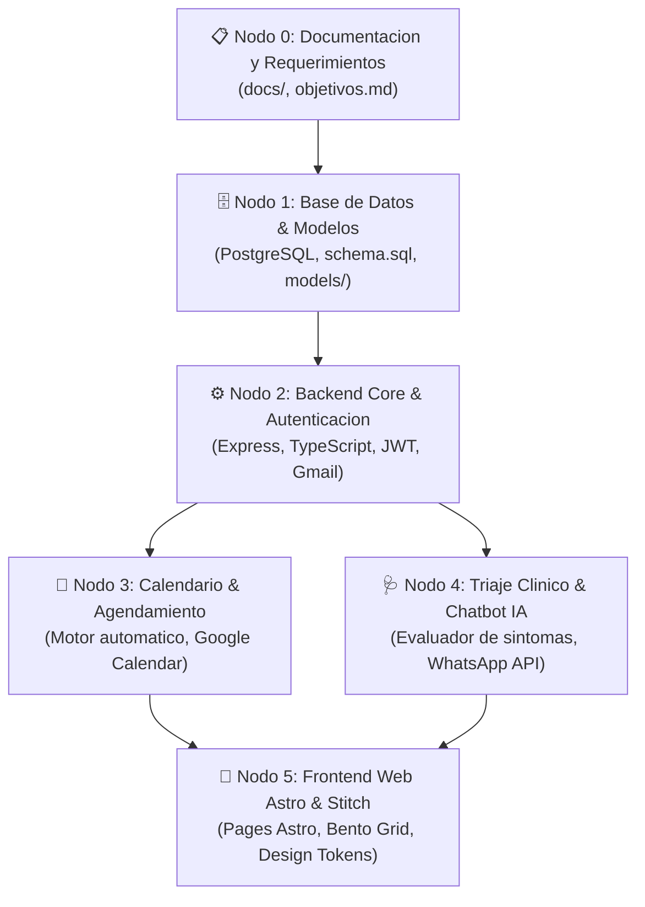

# MedPulse: Base de Conocimiento y Arquitectura Maestra (NotebookLM Edition)
# Sistema Inteligente de Gestion de Citas Clinicas y Triaje Automatizado

> **Version del Documento:** 1.0.0 (Consolidado Oficial)  
> **Fecha:** Octubre 2026  
> **Destino:** Google NotebookLM / Context Grounding  
> **Stack:** PostgreSQL 14+, Express / TypeScript, Astro 4+, Google Stitch, Obsidian, Anthropic Claude, Antigravity IDE  

---

## 1. Resumen Ejecutivo y Vision del Producto

**MedPulse** es una plataforma integral de gestion y agendamiento clinico de nueva generacion, disenada para erradicar el ausentismo de pacientes, eliminar la saturacion de las recepciones y automatizar el control de agendas medicas con cero solapamientos (*anti double-booking*).

### Objetivos Estrategicos
1. **Asistencia Inteligente y Triaje 24/7:** Chatbot conversacional integrado en WhatsApp y portal web que evalua la sintomatologia del paciente antes de agendar y clasifica la severidad (`LEVE`, `MODERADO`, `URGENTE`).
2. **Motor de Agendamiento Sin Eleccion Manual de Hora:** El paciente elige el medico, la especialidad y el dia deseado; el motor inteligente calcula y asigna en milisegundos la primera ranura libre disponible dentro del horario laboral del profesional, evitando colisiones en tiempo real.
3. **Cero Ausentismo (Anti No-Show):** Sincronizacion directa con **Google Calendar** y recordatorios automatizados multicanal (WhatsApp y correo).
4. **Portales Especializados por Rol:** Interfaces web optimizadas en **Astro** para 4 perfiles: *Paciente*, *Recepcionista*, *Medico* y *Administrador*.
5. **Estetica de Alta Gama (Bento Grid + Glassmorphism):** Superacion de los disenos clinicos obsoletos (fondos blancos planos) mediante una interfaz moderna tipo "Command Center", oscura, refractiva y vibrante basada en tokens esmeralda.

---

## 2. Red de Nodos de Arquitectura (Knowledge Graph)

El sistema esta modularizado en 6 Nodos quirurgicos:



### Detalle de Nodos:
* **Nodo 0 (Requerimientos):** `objetivos.md`, `README.md`, especificaciones de flujo en `docs/flows/`.
* **Nodo 1 (Base de Datos):** DDL `database/schemas/schema.sql`, modelos en `database/models/index.ts`, extensiones `uuid-ossp` y `btree_gist`.
* **Nodo 2 (Backend Core):** Servidor HTTP en `backend/src/server.ts`, rutas en `backend/src/routes/auth.routes.ts`, controladores en `auth.controller.ts`.
* **Nodo 3 (Agendamiento):** `citas.controller.ts`, `citas.routes.ts`, servicio anti-colision `agendamiento.service.ts` y `googleCalendar.service.ts`.
* **Nodo 4 (Triaje e IA):** `triaje.controller.ts`, `triaje.service.ts`, `chatbot.service.ts`.
* **Nodo 5 (Frontend):** Layout maestro `Layout.astro`, paginas por rol (`/login.astro`, `/paciente/reservar.astro`, `/citas.astro`), diseno Stitch y tokens en `DESIGN.md`.

---

## 3. Reglas de Negocio Inviolables (Business Logic Truths)

1. **Regla de Asignacion de Horarios (Inversion de Control):**
   - El paciente **NUNCA** elige la hora directamente en un calendario abierto.
   - Solo proporciona: `medicoId` (o especialidad requerida) y `fechaDeseada`.
   - El backend busca en `horarios_medicos` los intervalos laborales activos y descarta los que colisionen con `citas` existentes o `bloqueos_agenda_medicos`.
   - Asigna la ranura optima disponible y la confirma de inmediato.

2. **Garantia Anti-Colisiones (Zero Double-Booking):**
   - Ningun medico puede tener dos citas activas en el mismo rango temporal `[fecha_hora_inicio, fecha_hora_fin)`.
   - La base de datos y el servicio aplican bloqueos optimistas y verificacion previa antes del commit.

3. **Autenticacion con Google / Gmail:**
   - Todo paciente nuevo puede registrarse con su cuenta `@gmail.com` mediante el endpoint `POST /api/auth/register-paciente`.
   - Recibe inmediatamente su token JWT y un redireccionamiento dinamico a `/paciente`.

4. **Matriz de Triaje Clinico:**
   - **`LEVE` (Verde):** Sintomatologia no incapacitante. Se sugiere consulta externa general en plazo flexible.
   - **`MODERADO` (Amarillo):** Sintomas agudos sin riesgo vital inmediato. Cita prioritaria asignada en menos de 24-48 horas.
   - **`URGENTE` (Rojo):** Signos de alarma presentes (dolor toracico opresivo, disnea, perdida de conocimiento). Alerta inmediata de derivacion a emergencias hospitalarias con bloqueo de agendamiento estandar.

---

## 4. Modelo de Datos Relacional (PostgreSQL DDL)

El esquema relacional cuenta con 18 tablas optimizadas:

```
[roles] <--- [usuarios] <--- [pacientes]
                             [medicos] <--- [medicos_especialidades] ---> [especialidades]
                             [recepcionistas]
                             [administradores]

[medicos] ---> [horarios_medicos]
[medicos] ---> [bloqueos_agenda_medicos]
[medicos] ---> [citas] <--- [pacientes]
                 |
                 +---> [historial_citas_auditoria]
                 +---> [recordatorios_citas]
                 +---> [eventos_calendario_citas] <--- [calendarios_usuarios]

[conversaciones_chatbot] ---> [mensajes_chatbot]
```

### Estados del Ciclo de Vida de una Cita (`citas.estado`):
1. `PENDIENTE`: Registrada en el sistema, en espera de confirmacion o atencion.
2. `CONFIRMADA`: Confirmada por el paciente via WhatsApp o portal web.
3. `EN_CONSULTA`: Paciente siendo atendido por el medico.
4. `COMPLETADA`: Consulta finalizada satisfactoriamente.
5. `CANCELADA`: Cita anulada por el paciente o administracion con motivo registrado.
6. `NO_ASISTIO`: Paciente ausente al momento del turno (dispara metricas de ausentismo).

---

## 5. Contratos de APIs y Endpoints Clave

### A. Registro de Paciente
* **Ruta:** `POST /api/auth/register-paciente`
* **Payload:**
  ```json
  {
    "email": "carlos.mendoza@gmail.com",
    "password": "PasswordSegura123!",
    "nombres": "Carlos",
    "apellidos": "Mendoza Perez",
    "documento_tipo": "DNI",
    "documento_numero": "74892103",
    "telefono": "+51987654321"
  }
  ```
* **Respuesta Exitosa (201 Created):**
  ```json
  {
    "ok": true,
    "mensaje": "¡Paciente registrado exitosamente!",
    "token": "eyJhbGciOiJIUzI1NiIsInR5cCI6...",
    "usuario": {
      "id": "u-b87e2...",
      "email": "carlos.mendoza@gmail.com",
      "nombreCompleto": "Carlos Mendoza Perez",
      "rol": "PACIENTE",
      "redirectUrl": "/paciente"
    }
  }
  ```

### B. Asignacion Automatica de Cita
* **Ruta:** `POST /api/citas/asignar-automatica`
* **Payload:**
  ```json
  {
    "pacienteId": "p-10a4f...",
    "medicoId": "m-89c2d...",
    "fechaDeseada": "2026-10-25",
    "motivoConsulta": "Revision general y control de presion",
    "triajeId": "t-9021a..."
  }
  ```
* **Respuesta Exitosa (201 Created):**
  ```json
  {
    "ok": true,
    "mensaje": "Cita asignada y confirmada exitosamente sin colision",
    "cita": {
      "id": "c-44912...",
      "medicoNombre": "Dra. Elena Vasquez",
      "especialidad": "Cardiologia",
      "fechaHoraInicio": "2026-10-25T09:30:00Z",
      "fechaHoraFin": "2026-10-25T10:00:00Z",
      "consultorio": "Consultorio 304 - Ala Norte",
      "estado": "CONFIRMADA",
      "googleCalendarSync": true
    }
  }
  ```

### C. Evaluacion de Triaje Clinico
* **Ruta:** `POST /api/triaje/evaluar`
* **Payload:**
  ```json
  {
    "motivo": "Dolor de cabeza agudo y presion en el cuello",
    "sintomas": ["Cefalea", "Mareo", "Presion alta"],
    "tieneDolorPecho": false,
    "dificultadRespiratoria": false,
    "perdidaConocimiento": false,
    "temperatura": 37.1
  }
  ```
* **Respuesta Exitosa (200 OK):**
  ```json
  {
    "ok": true,
    "triaje": {
      "id": "tr-66291",
      "nivel": "MODERADO",
      "color": "#F59E0B",
      "prioridad": "Atencion prioritaria sugerida dentro de 24h",
      "especialidadSugerida": "Medicina General / Neurologia",
      "especialidadId": "esp-01"
    }
  }
  ```

---

## 6. Sistema de Diseno (Clinical Pulse Dark & Impeccable Style)

MedPulse implementa una direccion de arte moderna para interfaces clinicas, dejando atras los fondos blancos clinicos frios y adoptando un panel de control inmersivo:

### A. Paleta de Tokens Oficiales
* **Lienzo (Canvas):** Obsidian Slate Profundo (`#090D16` / `#0B0F19`).
* **Superficie de Vidrio (Glassmorphism):** `rgba(15, 23, 42, 0.70)` con `backdrop-filter: blur(16px)` y bordes refractivos de `1px solid rgba(255, 255, 255, 0.08)`.
* **Acento Primario de Salud:** Verde Esmeralda Neón (`#10B981` / `#059669`) con resplandor suave perimetral (`rgba(16, 185, 129, 0.25)`).
* **Acento de Triaje & Telemetria:** Cian Quirurgico (`#14B8A6`).
* **Acento de Alertas y Espera:** Ambar Calido (`#F59E0B`).
* **Acento Especialista & Admin:** Violeta Imperial (`#8B5CF6`).
* **Texto Primario:** Blanco Hielo de alta claridad (`#F8FAFC`).
* **Texto Secundario:** Gris Slate legible (`#94A3B8`).

### B. Reglas de Craft de Emil Kowalski e Impeccable Style:
1. **Regla Sub-300ms:** Toda transicion de estado, apertura de modales o drawer lateral debe completarse en 150-250ms con curvas de resorte o `ease-out`. Prohibido el `ease-in` en entradas.
2. **Respuesta Táctil (:active):** Todo boton comprimible y tarjeta clicable escala a `0.97` al presionar.
3. **Indicadores Vivos:** Medicos activos y turnos en tiempo real portan anillos con micro-animacion de pulso continuo (`animate-ping`).
4. **Cero AI Slop:** Prohibidos los textos con gradiente artificial, prohibidas las tarjetas dentro de tarjetas (*nested cards*), y prohibidos los emojis como iconos; uso exclusivo de vectores SVG limpios.
5. **Ergonomia Movil:** Area de toque minima de 44x44px en controles interactivos y barra fija inferior (*Bottom Navigation Bar*).

---

## 7. Preguntas de Oro para Explorar este Proyecto en NotebookLM

Al subir este documento a **Google NotebookLM**, puedes hacer preguntas como:

1. *"¿Cual es el algoritmo exacto para asignar una cita sin que el paciente elija la hora?"*
2. *"Genera una tabla comparativa con los 4 portales por rol (Paciente, Medico, Recepcion, Admin) y que funciones tiene cada uno."*
3. *"¿Como interactua el chatbot de WhatsApp con la clasificacion de triaje de tres niveles?"*
4. *"Escribe un prompt de Google Stitch para una pantalla de Administracion usando los tokens esmeralda y el Bento Grid."*
5. *"¿Cuales son los 5 antipatrones de diseno que tenemos estrictamente prohibidos segun Impeccable Style?"*
6. *"Genera un Audio Overview (Podcast Deep Dive) explicando la arquitectura de MedPulse y sus fortalezas frente a sistemas de citas tradicionales."*
