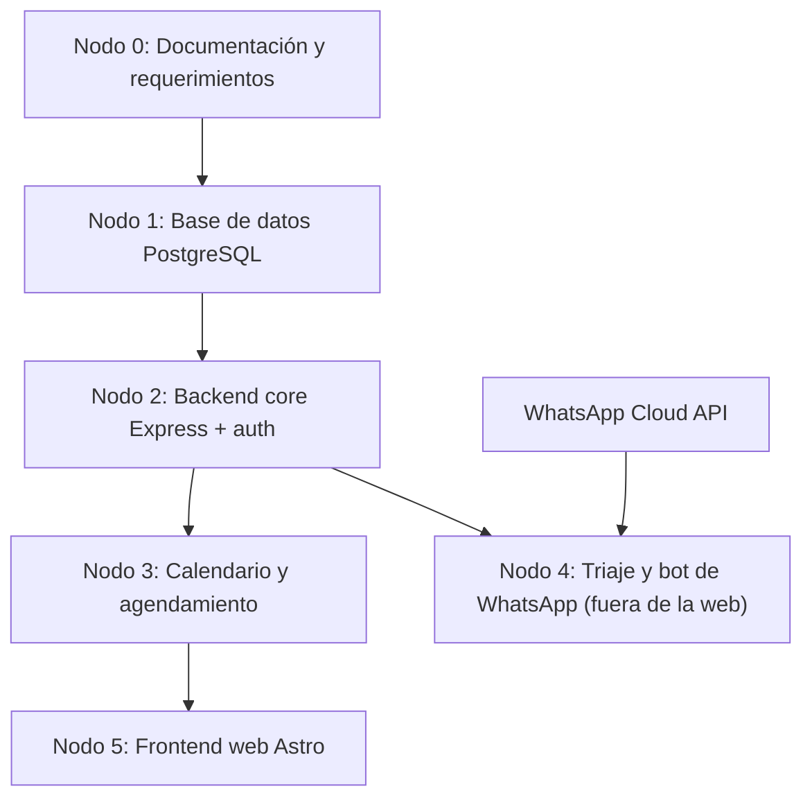

# MedPulse — Plan Maestro del Proyecto (Edición NotebookLM v2)
# Sistema Inteligente de Gestión de Citas Clínicas — Panamá

> **Versión:** 2.0.0  
> **Fecha:** 27 de octubre de 2026  
> **Destino:** Google NotebookLM (fuente de contexto del proyecto)  
> **Reemplaza en contenido a:** `MEDPULSE_NOTEBOOKLM_KNOWLEDGE_BASE.md` (v1.0.0, se conserva como histórico)  
> **Cambios clave v2:** despliegue en **Vercel sin dominio propio** · **chatbot fuera de la web, solo por WhatsApp** · correcciones del módulo de pacientes en Secretaría.

---

## 1. Resumen ejecutivo

**MedPulse** es una plataforma de agendamiento clínico para Panamá que elimina las citas duplicadas (*anti double-booking*), reduce el ausentismo y descongestiona la recepción.

- **Web (Astro):** portales para Paciente, Médico, Secretaría/Recepción y Administrador.
- **WhatsApp (canal externo):** el asistente conversacional / triaje vive **solo en WhatsApp**. La web **no** incluye chatbot.
- **Backend (Express + TypeScript):** API REST común para la web y para el bot de WhatsApp.
- **Base de datos:** PostgreSQL 14+ hospedado en la nube.
- **Hosting:** **Vercel**, usando las URLs gratuitas `*.vercel.app` (no se compra ni configura dominio propio).

---

## 2. Alcance

### 2.1 Dentro del alcance (web)
1. Login por rol y registro de pacientes con correo (Gmail) y cédula panameña.
2. Reserva de citas con **asignación automática de hora** (el paciente no elige la hora).
3. Gestión de citas por Secretaría (agendar a nombre del paciente, ver calendario).
4. Registro rápido de pacientes en recepción (mesa de entrada).
5. Agenda del médico, sus pacientes y horarios.
6. Administración: médicos, especialidades, consultorios, horarios, usuarios y roles.

### 2.2 Fuera de la web
- **Chatbot / asistente virtual / triaje conversacional:** se atiende **exclusivamente por WhatsApp**.
  - Se eliminaron de la web: el enlace "Asistente virtual" del menú del paciente, el botón "Asistente virtual IA", la tarjeta "Triaje IA" del panel y la lógica de chat del navegador.
  - El backend conserva `triaje.service.ts` y `chatbot.service.ts` porque el bot de WhatsApp los consumirá.
  - Las citas que entren por WhatsApp se registran con `canal_origen = 'CHATBOT_WHATSAPP'` y se ven en el calendario web como reservadas por el PACIENTE.

### 2.3 Fuera del alcance
- Dominio propio (se usa `*.vercel.app`).
- Expediente clínico electrónico completo.
- Pagos en línea.

---

## 3. Roles y portales

| Rol | Ruta base | Funciones principales |
|---|---|---|
| Paciente | `/paciente` | Mi panel, mis citas, reservar cita (hora automática), mi perfil médico |
| Médico | `/doctor` | Panel, agenda y citas, mis pacientes, turnos y horarios |
| Secretaría / Recepción | `/secretaria` | Mesa de recepción, gestión de citas, **recepción de pacientes**, médicos y consultorios |
| Administrador | `/` | Selector de portales, citas y calendario, pacientes, médicos, horarios, especialidades, consultorios, usuarios y roles |

**Regla de acceso:** un usuario con rol PACIENTE es redirigido a `/paciente/citas` si intenta abrir rutas administrativas (`/citas`, `/pacientes`, `/medicos`, etc.) o cualquier ruta de `/secretaria`.

---

## 4. Reglas de negocio inviolables

1. **Hora asignada por el sistema:** el paciente indica médico/especialidad y fecha; el backend calcula la primera ranura libre dentro de `horarios_medicos`, descartando choques con `citas` y `bloqueos_agenda_medicos`.
2. **Cero choques de agenda:** un médico no puede tener dos citas activas que se crucen en `[fecha_hora_inicio, fecha_hora_fin)`. Se garantiza con restricción de exclusión en PostgreSQL (`btree_gist`) y verificación previa en el servicio.
3. **Quién creó la cita:** `reservado_por` = `PACIENTE` (web o WhatsApp) o `ADMINISTRADOR` (secretaría/admin).
4. **Documento panameño:** cédula con formato `provincia-tomo-asiento` (ej. `8-1234-56789`, `E-8-123456`, `PE-1-1234`); también se acepta pasaporte.
5. **Sin duplicados de pacientes:** no se puede registrar dos veces el mismo documento o correo.
6. **Triaje (en WhatsApp):** LEVE (verde), MODERADO (ámbar, cita en 24–48 h) y URGENTE (rojo, se deriva a emergencias y no se agenda cita normal).

---

## 5. Arquitectura (Red de Nodos)



| Nodo | Responsable | Archivos clave |
|---|---|---|
| 0 Requerimientos | Angel (PM) | `objetivos.md`, `README.md`, `docs/` |
| 1 Base de datos | Elvis (DBA) | `database/init_local_db.sql`, `database/schemas/schema.sql`, `database/seeds/` |
| 2 Backend core | Angel | `backend/src/server.ts`, `backend/src/controllers/auth.controller.ts`, `backend/api/index.ts` |
| 3 Agendamiento | Angel / Elvis | `citas.controller.ts`, `agendamiento.service.ts`, `googleCalendar.service.ts` |
| 4 Triaje + WhatsApp | Angel | `triaje.service.ts`, `chatbot.service.ts` (consumidos por el bot) |
| 5 Frontend | Elias | `frontend/MedPulse_Astro/medpulse-astro/src/` |

---

## 6. Modelo de datos (resumen)

```
[roles] <- [usuarios] <- [pacientes]
                         [medicos] <- [medicos_especialidades] -> [especialidades]
                         [recepcionistas] [administradores]
[medicos] -> [horarios_medicos] / [bloqueos_agenda_medicos] / [citas] <- [pacientes]
[citas] -> [historial_citas_auditoria] / [recordatorios_citas] / [eventos_calendario_citas]
[conversaciones_chatbot] -> [mensajes_chatbot]   (alimentadas solo por WhatsApp)
```

**Estados de cita:** PENDIENTE → CONFIRMADA → EN_CONSULTA → COMPLETADA, o CANCELADA / NO_ASISTIO.

**Canales de origen (`canal_origen`):** `WEB_PACIENTE`, `RECEPCION`/`ADMINISTRADOR`, `CHATBOT_WHATSAPP`.

---

## 7. Contratos de API

URL base en producción: `https://<proyecto-backend>.vercel.app` (variable `PUBLIC_API_URL` en el frontend).

| Método | Ruta | Uso |
|---|---|---|
| GET | `/api/health` | Estado del servicio |
| POST | `/api/auth/login` | Inicio de sesión por rol |
| POST | `/api/auth/register-paciente` | Registro de paciente (web y recepción) |
| POST | `/api/citas/asignar-automatica` | Asigna la primera ranura libre |
| GET | `/api/citas/disponibilidad?medicoId=&fecha=` | Consulta de disponibilidad |
| POST | `/api/triaje/evaluar` | Triaje (lo usa el bot de WhatsApp) |
| GET | `/api/db/...` | Diagnóstico de conexión PostgreSQL |

**Registro de paciente — ejemplo de payload:**
```json
{
  "documento_tipo": "CEDULA_NACIONAL",
  "documento_numero": "8-1234-56789",
  "nombres": "Carlos",
  "apellidos": "Mendoza Pérez",
  "email": "carlos.mendoza@gmail.com",
  "telefono": "+507 6123-4567",
  "fecha_nacimiento": "1990-05-10",
  "genero": "MASCULINO"
}
```
Respuestas: `201` con `{ ok, usuario, paciente, token }`; `400` si faltan campos; `409` si el correo ya existe.

---

## 8. Despliegue en Vercel (sin dominio propio)

Se crean **dos proyectos** en Vercel desde el mismo repositorio (`AngelBroce/sistema-citas-clinicas`):

### 8.1 Proyecto Frontend
- **Root Directory:** `frontend/MedPulse_Astro/medpulse-astro`
- **Framework:** Astro (detección automática), salida estática (`output: 'static'`).
- **Build:** `npm run build` · **Output:** `dist`
- **Variable de entorno:** `PUBLIC_API_URL=https://<proyecto-backend>.vercel.app`
- **URL resultante:** `https://<proyecto-frontend>.vercel.app`

### 8.2 Proyecto Backend
- **Root Directory:** `backend`
- Función serverless en `backend/api/index.ts` (exporta la app Express).
- `backend/vercel.json` redirige todas las rutas a `/api`.
- `server.ts` **no** llama a `listen()` cuando existe `process.env.VERCEL`; en local funciona igual que antes (`npm run dev`, puerto 4000).
- **Variables de entorno:**
  - `DATABASE_URL` → PostgreSQL en la nube (Neon / Supabase / Vercel Postgres) con `?sslmode=require`.
  - `CORS_ORIGIN` → URL del frontend (las URLs `*.vercel.app` ya se aceptan automáticamente).
  - `GOOGLE_CLIENT_ID`, `GOOGLE_CLIENT_SECRET`, `GOOGLE_REDIRECT_URI=https://<proyecto-backend>.vercel.app/api/calendar/callback`.

### 8.3 Consideraciones importantes
- **Serverless = sin memoria persistente:** el almacén en memoria del backend (`USUARIOS_REGISTRADOS`) se pierde entre ejecuciones; en producción **la fuente de verdad debe ser PostgreSQL**.
- **Base de datos:** ejecutar `database/init_local_db.sql` una sola vez sobre la base en la nube.
- **Respaldo local en el navegador:** si el backend no responde, el frontend guarda temporalmente pacientes y citas en `localStorage` para no bloquear la recepción (modo demo / contingencia).
- **WhatsApp:** el webhook del bot apuntará a `https://<proyecto-backend>.vercel.app/api/...` (también sin dominio propio).

---

## 9. Canal WhatsApp (asistente fuera de la web)

1. El paciente escribe al número de WhatsApp de la clínica.
2. WhatsApp Cloud API envía el mensaje al webhook del backend en Vercel.
3. El backend usa `chatbot.service.ts` + `triaje.service.ts` para clasificar (LEVE / MODERADO / URGENTE).
4. Si procede, llama a `asignar-automatica` y responde con fecha, hora y consultorio.
5. La cita aparece en el calendario web con `canal_origen = CHATBOT_WHATSAPP`.
6. Conversaciones guardadas en `conversaciones_chatbot` y `mensajes_chatbot`.

---

## 10. Estado actual y correcciones recientes (27-oct-2026)

### Secretaría → Recepción de pacientes (`/secretaria/pacientes`)
| Problema | Corrección |
|---|---|
| El formulario no guardaba nada (solo mostraba un aviso y limpiaba) | Ahora registra vía `POST /api/auth/register-paciente`; si el servidor no responde, guarda localmente y avisa en ámbar |
| El buscador no funcionaba | Filtro en vivo por nombre, cédula, correo y teléfono, con mensaje "sin resultados" |
| Los pacientes nuevos no aparecían en el directorio | Directorio dinámico: base + nuevos (con etiqueta "Nuevo") y contador |
| "+ Cita" no preseleccionaba al paciente (`pacienteId` no era leído) | Enlace corregido a `paciente_id_select`, y Reservar acepta los tres nombres de parámetro |
| Documentos y teléfono con formato de Perú (DNI, +51) | Cédula panameña / cédula E / pasaporte y teléfono +507, con validación de formato |
| Se podían duplicar pacientes | Validación por documento y correo |
| La barra inferior móvil de Secretaría llevaba a rutas de Admin | Ahora apunta a `/secretaria`, `/secretaria/citas` y agendar en modo recepción |

### Despliegue
- URLs `http://localhost:4000` fijas reemplazadas por `PUBLIC_API_URL` (`src/data/api.ts`).
- Backend listo para Vercel (`api/index.ts`, `vercel.json`, CORS para `*.vercel.app`).
- Plantillas `.env.example` en frontend y backend.

### Dashboard de Administración & Telemetría Ejecutiva (`/dashboard`)
- **Centro de Control Interactivo:** Nuevo dashboard dinámico para el perfil Administrador (`src/pages/dashboard.astro`).
- **Animaciones y Telemetría en Vivo:**
  - Contadores KPI interpolados numéricamente con aceleración y rebote suave vía `requestAnimationFrame`.
  - Gráfico de barras verticales por especialidad (Medicina General, Pediatría, Cardiología, etc.) con elevación escalonada `@keyframes barRise`.
  - Mapa de calor de ocupación horaria y días de mayor saturación.
  - Medidores visuales de ocupación física en tiempo real por consultorio (101 a 203).
  - Desglose porcentual interactivo de canales de reserva (`WEB_PACIENTE`, `RECEPCION`, `CHATBOT_WHATSAPP`).
  - Feed reactivo de citas recientes con filtros de periodo (Hoy, Esta semana, Este mes) y badges de estado en vivo.
- **Enlace Principal de Admin:** Accesible directamente desde la barra superior (`/dashboard`), menú lateral y selector de portales.

### Pendientes
- [ ] Decidir si se eliminan los archivos `src/pages/asistente.astro` y `src/pages/paciente/asistente.astro` (ya no tienen enlaces).
- [ ] Crear la base PostgreSQL en la nube y cargar el script inicial.
- [ ] Crear los dos proyectos en Vercel y cargar las variables de entorno.
- [x] Implementar el webhook de WhatsApp Cloud API en el backend (`backend/src/controllers/whatsapp.controller.ts`, `backend/src/routes/whatsapp.routes.ts`).
- [ ] Mover la persistencia de pacientes/citas de memoria a PostgreSQL en todos los endpoints.

---

## 11. Sistema de diseño (resumen)

- Fondo oscuro slate `#0B0F19`, superficies de vidrio `rgba(15,23,42,0.7)` con blur.
- Acentos: esmeralda `#10B981` (salud), ámbar `#F59E0B` (alertas), violeta `#8B5CF6` (admin), cian `#06B6D4` (telemetría).
- Transiciones de 150–250 ms con `ease-out`; botones que se comprimen a `0.97` al presionar.
- Mobile-first con barra de navegación inferior y áreas táctiles de al menos 44×44 px.

---

## 12. Preguntas sugeridas para NotebookLM

1. "¿Cómo se asigna una cita sin que el paciente elija la hora?"
2. "¿Qué hace cada portal (Paciente, Médico, Secretaría, Admin)?"
3. "¿Cómo valida el backend el webhook de WhatsApp Cloud API con Meta?"
4. "¿Cómo se procesan los síntomas de un paciente en WhatsApp y qué responde si es urgente?"
5. "¿Qué pasos faltan para dejar MedPulse funcionando en Vercel?"
6. "Genera un resumen en audio de la arquitectura de MedPulse."

---

## 13. Especificación del Webhook de WhatsApp Cloud API (Implementado)

Para cumplir con el canal exterior exclusivo de WhatsApp, se crearon los controladores y rutas en el backend:

### 13.1 Endpoints del Webhook
| Método | Ruta | Propósito |
|---|---|---|
| `GET` | `/api/whatsapp/webhook` | Handshake de suscripción con Meta (`hub.mode === 'subscribe'`, `hub.verify_token`). Token por defecto: `medpulse_wa_secure_2026`. |
| `POST` | `/api/whatsapp/webhook` | Recepción de eventos y mensajes entrantes de Meta. Responde `200 EVENT_RECEIVED` y procesa en segundo plano. |
| `POST` | `/api/whatsapp/simular` | Endpoint de prueba local/QA para simular mensajes entrantes sin credenciales de Meta. |

### 13.2 Reglas de Triaje Conversacional en WhatsApp
1. **Detección URGENTE (Alerta Roja):** Si el paciente menciona dolor de pecho, falta de aire, desmayos o convulsiones, el bot emite una alerta roja médica inmediata orientando a acudir de urgencia a un hospital y **bloquea el agendamiento regular**.
2. **Detección MODERADO / LEVE (Verde y Ámbar):** Clasifica la especialidad sugerida (Medicina General, Pediatría, etc.) e instruye al paciente para responder con su Cédula Panameña y fecha para la asignación automática de la cita con `canal_origen = 'CHATBOT_WHATSAPP'`.

